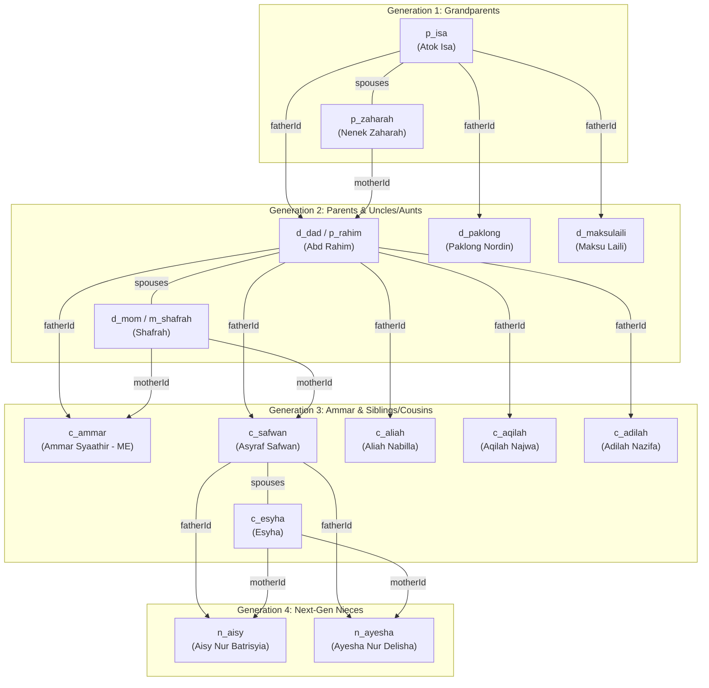

# 🌳 Ammar Syaathir Family Heritage Archive (Four Generations)

> **Academic Project:** ITT588 – Front-End Technology (Lab Work 4)  
> **Student:** Muhammad Ammar Syaathir Bin Abd Rahim  
> **Student ID:** 2025179251 &middot; **Class Group:** CS2666B  
> **Faculty:** Faculty of Computer & Mathematical Sciences, Universiti Teknologi MARA (UiTM)  
> **Lecturer:** Sir Shahadan Saad  
> **Production Live URL:** [https://ammar-family-heritage.pages.dev/](https://ammar-family-heritage.pages.dev/)

---

## 📖 Executive Summary & Architectural Overview

The **Ammar Syaathir Family Heritage Archive** is an interactive, real-time Jamstack web application architected to document, visualize, and explore **four generations** of family genealogy comprising **68 relatives** across **12 distinct family units**. 

Designed with an ultra-refined **Heritage Emerald & Gold** design system (`#14362B`, `#0E2A21`, `#B58B3F`, `#FAF8F5`), the system delivers a zero-dependency, ultra-fast 60 FPS user experience backed by serverless edge synchronization.

```
+-----------------------------------------------------------------------------------+
|                                  USER BROWSER                                     |
|  [ index.html ]        [ family.html ]        [ directory.html ]   [ stats.html ] |
|   Portal Hub            Tree Engine            Directory Engine     Demographics  |
+-----------------------------------------------------------------------------------+
                                          |
                                          | (Plain ES6+ MVC Controller)
                                          v
+-----------------------------------------------------------------------------------+
|                        Client Controller: familyApp.js                            |
|   State Management  |  Tree Generator  |  Filter Engine  |  Reactive Auto-Save    |
+-----------------------------------------------------------------------------------+
                                          |
                      +-------------------+-------------------+
                      | (HTTP REST API)                       | (Offline Fallback)
                      v                                       v
+------------------------------------------+    +-----------------------------------+
|     Cloudflare Pages Functions           |    |     Static JSON Seed File         |
|     /api/people (GET, POST)              |    |     dist/public/data/people.json  |
|     /api/people/:id (GET, PUT, DELETE)   |    +-----------------------------------+
|     /api/people/bulk (POST)              |
+------------------------------------------+
                      |
                      v
+------------------------------------------+
|     Cloudflare D1 SQL Database           |
|     (Global edge-distributed SQLite)     |
+------------------------------------------+
```

---

## 🛠️ Framework, Technologies & Design System

### 1. Technology Stack
* **Front-End Architecture:** Pure Jamstack (HTML5 Semantic Markup + CSS3 Modern Variables + Vanilla JavaScript ES6+). Zero bloated runtime frameworks (no React, Vue, or Angular) ensures sub-millisecond initial renders and zero build friction.
* **Typography & Iconography:** 
  * *Headings & Badges:* `Cormorant Garamond` (classic serif warmth)
  * *Body & Controls:* `Plus Jakarta Sans` (ergonomic clean sans-serif)
  * *Identifiers & Metrics:* `JetBrains Mono` (monospace precision)
  * *Icons:* `FontAwesome 6.5.2 Pro/Free SVG`
* **Edge Serverless Backend:** Cloudflare Pages Functions running on V8 isolates with global edge distribution.
* **Database Engine:** Cloudflare D1 (serverless relational SQLite running at the edge).
* **Local Development & Deployment Tooling:** Node.js, Cloudflare Wrangler CLI.

### 2. Design System Tokens
| Token | HEX / Value | Role / Usage |
|---|---|---|
| `--primary` / `--ruby` | `#14362B` | Heritage Deep Pine / Primary Brand Surface |
| `--primary-dark` | `#0E2A21` | Forest Shadow / High-contrast accents & headers |
| `--primary-light` | `#2F6B55` | Emerald Mid-tone / Interactive hover states |
| `--gold` / `--amber` | `#B58B3F` | Heritage Gold / Focus rings, crowns, key borders |
| `--cream` | `#FBF9F5` | Parchment Silk / App background & subtle cards |
| `--surface` | `#FFFFFF` | Clean White / Elevating member cards and dialogs |

---

## 📁 Repository & Directory Structure

```
AMMAR FAMILY HERITAGE/
├── dist/                                # Production web app root (Cloudflare Pages deploy target)
│   ├── index.html                       # Home portal landing page & academic project showcase
│   ├── family.html                      # Interactive 4-generation visual pedigree tree
│   ├── directory.html                   # 3-mode member directory, multi-filters & modals
│   ├── stats.html                       # Demographics & intelligence dashboard
│   ├── _headers                         # Security headers & cache-control policies
│   ├── _redirects                       # SPA & custom URL routing rules
│   ├── robots.txt                       # Search engine crawler policies
│   └── public/                          # Static public resources
│       ├── favicon.svg                  # Brand crest SVG icon
│       ├── images/                      # Image assets directory (.gitkeep)
│       ├── data/
│       │   └── people.json              # Static seed database (68 members, 4 generations)
│       └── js/
│           └── familyApp.js             # Core MVC controller & visualization engine
├── functions/                           # Cloudflare Serverless Pages Functions (API Backend)
│   ├── _lib/
│   │   └── people.js                    # Database ORM, D1 queries, SQL migrations & helpers
│   └── api/
│       └── people/
│           ├── index.js                 # Handler for GET /api/people and POST /api/people
│           ├── [id].js                  # Handler for GET, PUT, and DELETE /api/people/:id
│           └── bulk.js                  # Handler for POST /api/people/bulk (batch database import)
├── db/
│   └── schema.sql                       # D1 SQLite table DDL & default dataset seed queries
├── package.json                         # Project metadata, NPM dependencies, and deployment scripts
├── wrangler.toml                        # Cloudflare Pages & D1 database binding configuration
├── .gitignore                           # Git exclusion rules (node_modules, wrangler, screenshots)
└── README.md                            # Complete technical specification and genealogy guide
```

---

## 🧬 Data Model & JSON Schema Explanation

Each family relative in `people.json` and the Cloudflare D1 database adheres to the following strict relational schema:

```json
{
  "id": "c_ammar",
  "name": "Muhammad Ammar Syaathir Bin Abd Rahim",
  "gender": "male",
  "dob": "2004-09-14",
  "age": 22,
  "generation": 3,
  "branch": "immediate",
  "familyUnit": "core_ammar",
  "familyLabel": "Ammar Immediate Family",
  "city": "Rembau, Negeri Sembilan",
  "profession": "Computer Science Student (UiTM)",
  "bio": "Lead developer and author of the family heritage archive.",
  "fatherId": "d_dad",
  "motherId": "d_mom",
  "spouses": [],
  "children": [],
  "isInLaw": false,
  "avatar": "data:image/jpeg;base64,..."
}
```

### Field Breakdown & Validation Rules:

| Field | Type | Description |
|---|---|---|
| `id` | `String` (Unique) | Primary Key identifier prefixed by lineage code (`p_`, `m_`, `d_`, `c_`, `n_`). |
| `name` | `String` | Formal registered full name. |
| `gender` | `"male" \| "female"` | Biological gender for avatar styling and relationship badges. |
| `dob` | `String (YYYY-MM-DD)` | Date of Birth. Used to dynamically calculate precise age and upcoming birthdays. |
| `age` | `Number` | Computed or recorded age in years. |
| `generation` | `Number (1-4)` | Hierarchical generation tier (Gen 1 = Grandparents, Gen 2 = Parents/Aunts/Uncles, Gen 3 = Ammar & Cousins, Gen 4 = Nieces). |
| `branch` | `"immediate" \| "paternal" \| "maternal"` | Lineage partition for filtered pedigree trees. |
| `familyUnit` | `String` | Household group key (e.g., `core_ammar`, `pl_paklong`, `ms_maksulaili`, etc.). |
| `familyLabel` | `String` | Human-readable household name displayed on badges and accordions. |
| `city` | `String` | Residential locality used for regional demographic grouping. |
| `fatherId` | `String \| null` | Relational pointer (`id`) linking upward to biological father. |
| `motherId` | `String \| null` | Relational pointer (`id`) linking upward to biological mother. |
| `spouses` | `Array<{id, status}>` | Array of marital connections containing spouse ID and status (`"married"`). |
| `children` | `Array<String>` | Array of relational pointers to child member IDs. |
| `isInLaw` | `Boolean` | Flag indicating whether the person joined via marriage rather than biological descent. |
| `avatar` | `String` | Base64 data URI string or URL of uploaded photographic portrait. |

---

## 🔄 ID Inheritance & Relational Flow Architecture

The core of the family tree is a **bidirectional relational graph** connecting nodes through upward ancestry, downward descent, and horizontal partnership.



### Relational Consistency Engine:
1. **Upward Inheritance (`fatherId`, `motherId`):** When adding a child, assigning their `fatherId` and `motherId` automatically creates downward branches in the tree.
2. **Downward Pedigree (`children: [...]`):** Any person added as a child is simultaneously pushed into the father's and mother's `children` arrays.
3. **Horizontal Marital Bonding (`spouses: [...]`):** Selecting a spouse for Person A updates Person A's `spouses` array and automatically creates reciprocal spouse linkage for Person B.
4. **Visual Tree Rendering (`renderTreePersonOrCouple`):** If a person has a registered spouse, the tree engine dynamically renders a unified couple node with a central heart connector (`♥`), branching downward to their shared children.

---

## 🖥️ User Interfaces & Feature Breakdown

### 1. Family Tree (`family.html`)
* **Lineage Switching:** Toggle instantly between:
  * **Core Family:** Focus on immediate parents, siblings, and nieces.
  * **Dad's Side (Paternal):** Paternal grandparents (Atok Isa & Nenek Zaharah), paternal uncles, aunts, and first cousins.
  * **Mom's Side (Maternal):** Maternal grandparents (Atok Zain & Nenek Noraini) and maternal households.
* **Canvas Zoom & Pan:** Native interactive scaling from **65% to 140%** with reset button and zoom level badge.
* **Spotlight Search:** Auto-locates, scrolls, and visually pulses any selected relative in the tree canvas.

### 2. Member Directory (`directory.html`)
* **Three View Modes:**
  * **Cards Grid (`data-view-mode="grid"`):** Modern multi-column layout showing cards with Name, BOD - Age, City, Lineage context, and 4 quick actions.
  * **By Family (`data-view-mode="grouped"`):** Collapsible accordion grouping relatives by nuclear households with relative count badges.
  * **Table View (`data-view-mode="table"`):** Clean 5-column table strictly presenting **Member**, **Household**, **BOD**, **City**, and **Action**.
* **Filter & Search Engine:**
  * Real-time search by Name, Nickname, City, or Profession.
  * Dropdown filters: Family Unit, Lineage Branch, Generation Tier, Gender, and City.
  * Live filter counter (e.g., `Showing 10 of 68 documented family members`) with removable filter chips.
* **Card Actions:**
  * `Tree`: Spotlights relative on the tree.
  * `Edit`: Opens the interactive editor.
  * `Profile`: Opens the full photo profile modal.
  * `Copy ID`: Copies profile summary and triggers a floating toast notification.

### 3. Add & Edit Member Modal
* Interactive dropdown selectors for **Family Unit**, **Father**, and **Mother**.
* **Spouse Selector:** Dropdown selector with removeable chip badges.
* **Children Multi-Selector:** Dropdown selector allowing multiple children to be added one by one, rendering distinct removable avatar chips.
* **Real-time Photo Upload:** Local device image picker with auto-cropping and base64 compression.

### 4. Heritage Stats & Demographics (`stats.html`)
* **6 Key Performance Indicators:** Total Members (68), Generations Span (4), Average Age (37.5 yrs), Active Households (12), Gender Balance (27M / 41F), Age Range (0 - 85 yrs).
* **Interactive Lineage Donut Chart:** Visual breakdown of Paternal, Maternal, and Immediate relatives.
* **Generational Hierarchy:** Tiered progress bars for Generations 1 through 4.
* **Milestone Calendar:** Chronological list of upcoming birthdays and ages.

---

## 🚀 Deployment & Local Setup

### Running Locally
```bash
# 1. Install dependencies
npm install

# 2. Run local Cloudflare Pages dev server with local D1 database
npm run dev
# Server boots at http://localhost:8788
```

### Deploying to Cloudflare Pages
```bash
# Deploy static dist directory and serverless functions directly
npx wrangler pages deploy dist --project-name ammar-family-heritage
```

---

## 📄 License & Academic Attribution
* **Author:** Muhammad Ammar Syaathir Bin Abd Rahim (2025179251)
* **Course:** ITT588 Front-End Technology &middot; Universiti Teknologi MARA (UiTM)
* **Year:** 2026
