# 🌳 Ammar Syaathir Family Heritage Archive (Four Generations)

> **Academic Project:** ITT588 – Front-End Technology (Lab Work 4)  
> **Student:** Muhammad Ammar Syaathir Bin Abd Rahim  
> **Student ID:** 2025179251 &middot; **Class Group:** CS2666B  
> **Faculty:** Faculty of Computer & Mathematical Sciences, Universiti Teknologi MARA (UiTM)  
> **Lecturer:** Sir Shahadan Saad  
> **Production Live URL:** [https://ammar-family-heritage.pages.dev/](https://ammar-family-heritage.pages.dev/)  
> **GitHub Repository:** [https://github.com/ammarsyaathir/family-tree](https://github.com/ammarsyaathir/family-tree)

---

## 📖 Executive Summary & Architectural Overview

The **Ammar Syaathir Family Heritage Archive** is an interactive, real-time Jamstack web application architected to document, visualize, and explore **four generations** of family genealogy comprising **68 relatives** across **12 distinct family units**. 

Designed with an ultra-refined **Heritage Emerald & Gold** design system (`#14362B`, `#0E2A21`, `#B58B3F`, `#FAF8F5`), the system delivers a zero-dependency, ultra-fast 60 FPS user experience backed by serverless edge synchronization.

```
+-----------------------------------------------------------------------------------+
|                                  USER BROWSER                                     |
|  [ index.html ]        [ family.html ]        [ directory.html ]   [ stats.html ] |
|   Portal Hub            Tree Engine            Directory Engine     Demographics  |
+-----------------------------------------------------------------------------------+
                                          |
                                          | (Plain ES6+ MVC Controller)
                                          v
+-----------------------------------------------------------------------------------+
|                        Client Controller: familyApp.js                            |
|   State Management  |  Tree Generator  |  Filter Engine  |  Reactive Auto-Save    |
+-----------------------------------------------------------------------------------+
                                          |
                      +-------------------+-------------------+
                      | (HTTP REST API)                       | (Offline Fallback)
                      v                                       v
+------------------------------------------+    +-----------------------------------+
|     Cloudflare Pages Functions           |    |     Static JSON Seed File         |
|     /api/people (GET, POST)              |    |     dist/public/data/people.json  |
|     /api/people/:id (GET, PUT, DELETE)   |    +-----------------------------------+
|     /api/people/bulk (POST)              |
+------------------------------------------+
                      |
                      v
+------------------------------------------+
|     Cloudflare D1 SQL Database           |
|     (Global edge-distributed SQLite)     |
+------------------------------------------+
```

---

## 🛠️ Framework, Technologies & Design System

### 1. Technology Stack
* **Front-End Architecture:** Pure Jamstack (HTML5 Semantic Markup + CSS3 Modern Variables + Vanilla JavaScript ES6+). Zero bloated runtime frameworks (no React, Vue, or Angular) ensures sub-millisecond initial renders and zero build friction.
* **Typography & Iconography:** 
  * *Headings & Badges:* `Cormorant Garamond` (classic serif warmth)
  * *Body & Controls:* `Plus Jakarta Sans` (ergonomic clean sans-serif)
  * *Identifiers & Metrics:* `JetBrains Mono` (monospace precision)
  * *Icons:* `FontAwesome 6.5.2 Pro/Free SVG`
* **Edge Serverless Backend:** Cloudflare Pages Functions running on V8 isolates with global edge distribution.
* **Database Engine:** Cloudflare D1 (serverless relational SQLite running at the edge).
* **Local Development & Deployment Tooling:** Node.js, Cloudflare Wrangler CLI.

### 2. Design System Tokens
| Token | HEX / Value | Role / Usage |
|---|---|---|
| `--primary` / `--ruby` | `#14362B` | Heritage Deep Pine / Primary Brand Surface |
| `--primary-dark` | `#0E2A21` | Forest Shadow / High-contrast accents & headers |
| `--primary-light` | `#2F6B55` | Emerald Mid-tone / Interactive hover states |
| `--gold` / `--amber` | `#B58B3F` | Heritage Gold / Focus rings, crowns, key borders |
| `--cream` | `#FBF9F5` | Parchment Silk / App background & subtle cards |
| `--surface` | `#FFFFFF` | Clean White / Elevating member cards and dialogs |

---

## 📁 Repository & Directory Structure

```
AMMAR FAMILY HERITAGE/
├── dist/                                # Production web app root (Cloudflare Pages deploy target)
│   ├── index.html                       # Home portal landing page & academic project showcase
│   ├── family.html                      # Interactive 4-generation visual pedigree tree
│   ├── directory.html                   # 3-mode member directory, multi-filters & modals
│   ├── stats.html                       # Demographics & intelligence dashboard
│   ├── _headers                         # Security headers & cache-control policies
│   ├── _redirects                       # SPA & custom URL routing rules
│   ├── robots.txt                       # Search engine crawler policies
│   └── public/                          # Static public resources
│       ├── favicon.svg                  # Brand crest SVG icon
│       ├── images/                      # Image assets directory (.gitkeep)
│       ├── data/
│       │   └── people.json              # Static seed database (68 members, 4 generations)
│       └── js/
│           └── familyApp.js             # Core MVC controller & visualization engine
├── functions/                           # Cloudflare Serverless Pages Functions (API Backend)
│   ├── _lib/
│   │   └── people.js                    # Database ORM, D1 queries, SQL migrations & helpers
│   └── api/
│       └── people/
│           ├── index.js                 # Handler for GET /api/people and POST /api/people
│           ├── [id].js                  # Handler for GET, PUT, and DELETE /api/people/:id
│           └── bulk.js                  # Handler for POST /api/people/bulk (batch database import)
├── screenshots/                         # High-resolution 2x DPR visual captures of all app views
├── db/
│   └── schema.sql                       # D1 SQLite table DDL & default dataset seed queries
├── package.json                         # Project metadata, NPM dependencies, and deployment scripts
├── wrangler.toml                        # Cloudflare Pages & D1 database binding configuration
├── .gitignore                           # Git exclusion rules (node_modules, wrangler cache)
└── README.md                            # Complete technical specification and genealogy guide
```

---

## 🧬 Data Model & JSON Schema Explanation

Each family relative in `people.json` and the Cloudflare D1 database adheres to the following strict relational schema:

```json
{
  "id": "c_ammar",
  "name": "Muhammad Ammar Syaathir Bin Abd Rahim",
  "gender": "male",
  "dob": "2004-09-14",
  "age": 22,
  "generation": 3,
  "branch": "immediate",
  "familyUnit": "core_ammar",
  "familyLabel": "Ammar Immediate Family",
  "city": "Rembau, Negeri Sembilan",
  "profession": "Computer Science Student (UiTM)",
  "bio": "Lead developer and author of the family heritage archive.",
  "fatherId": "d_dad",
  "motherId": "d_mom",
  "spouses": [],
  "children": [],
  "isInLaw": false,
  "avatar": "data:image/jpeg;base64,..."
}
```

### Field Breakdown & Validation Rules:

| Field | Type | Description |
|---|---|---|
| `id` | `String` (Unique) | Primary Key identifier prefixed by lineage code (`p_`, `m_`, `d_`, `c_`, `n_`). |
| `name` | `String` | Formal registered full name. |
| `gender` | `"male" \| "female"` | Biological gender for avatar styling and relationship badges. |
| `dob` | `String (YYYY-MM-DD)` | Date of Birth. Used to dynamically calculate precise age and upcoming birthdays. |
| `age` | `Number` | Computed or recorded age in years. |
| `generation` | `Number (1-4)` | Hierarchical generation tier (Gen 1 = Grandparents, Gen 2 = Parents/Aunts/Uncles, Gen 3 = Ammar & Cousins, Gen 4 = Nieces). |
| `branch` | `"immediate" \| "paternal" \| "maternal"` | Lineage partition for filtered pedigree trees. |
| `familyUnit` | `String` | Household group key (e.g., `core_ammar`, `pl_paklong`, `ms_maksulaili`, etc.). |
| `familyLabel` | `String` | Human-readable household name displayed on badges and accordions. |
| `city` | `String` | Residential locality used for regional demographic grouping. |
| `fatherId` | `String \| null` | Relational pointer (`id`) linking upward to biological father. |
| `motherId` | `String \| null` | Relational pointer (`id`) linking upward to biological mother. |
| `spouses` | `Array<{id, status}>` | Array of marital connections containing spouse ID and status (`"married"`). |
| `children` | `Array<String>` | Array of relational pointers to child member IDs. |
| `isInLaw` | `Boolean` | Flag indicating whether the person joined via marriage rather than biological descent. |
| `avatar` | `String` | Base64 data URI string or URL of uploaded photographic portrait. |

---

## 🔄 ID Inheritance & Relational Flow Architecture

The core of the family tree is a **bidirectional relational graph** connecting nodes through upward ancestry, downward descent, and horizontal partnership.

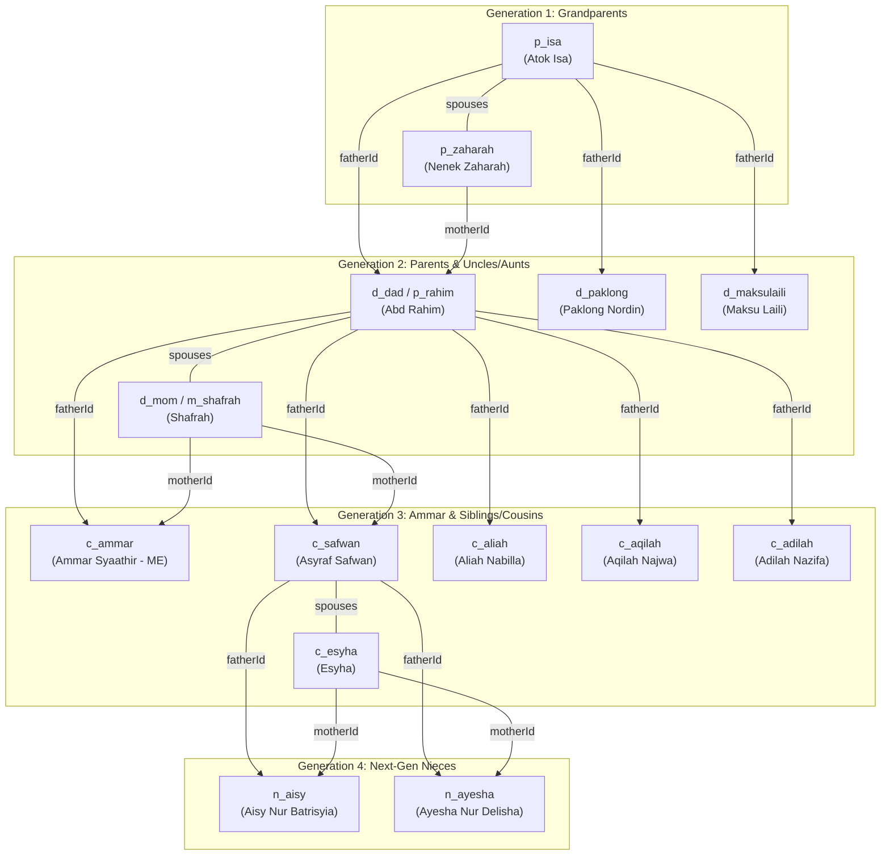

### Relational Consistency Engine:
1. **Upward Inheritance (`fatherId`, `motherId`):** When adding a child, assigning their `fatherId` and `motherId` automatically creates downward branches in the tree.
2. **Downward Pedigree (`children: [...]`):** Any person added as a child is simultaneously pushed into the father's and mother's `children` arrays.
3. **Horizontal Marital Bonding (`spouses: [...]`):** Selecting a spouse for Person A updates Person A's `spouses` array and automatically creates reciprocal spouse linkage for Person B.
4. **Visual Tree Rendering (`renderTreePersonOrCouple`):** If a person has a registered spouse, the tree engine dynamically renders a unified couple node with a central heart connector (`♥`), branching downward to their shared children.

---

## 🖥️ User Interfaces & Visual Walkthrough (All 19 Screenshots)

Below is the complete visual documentation of every page, view mode, modal interface, and interactive filtering capability implemented in the archive:

### 1. Heritage Portal & Landing Experience

#### View 10: Home / Landing Page
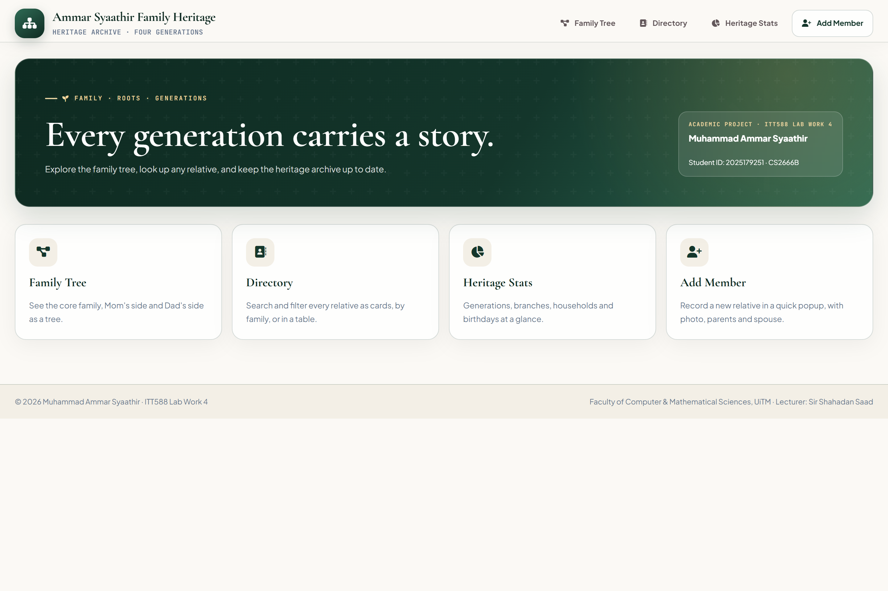
* **File:** `screenshots/10_home_landing.png`
* **Features:** Heritage hero banner featuring student credentials (**Muhammad Ammar Syaathir Bin Abd Rahim**, ID `2025179251`, Group `CS2666B`, Course `ITT588 Lab Work 4`), course institution attribution, and 4 quick-access portal hub cards for direct navigation to the Family Tree, Directory, Heritage Stats, and Add Member form.

---

### 2. Interactive Family Tree Visualizer (`family.html`)

#### View 01: Core Family Tree (Full Page)
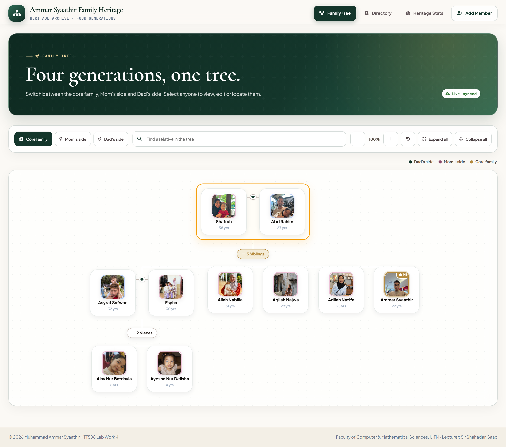
* **File:** `screenshots/01_my_tree_full.png`
* **Features:** Clean visual pedigree view of the immediate core family: parents (Abd Rahim & Shafrah) rendered as a married couple card with central heart link, branching downward into the 5 siblings row with Ammar prominently distinguished with a gold `👑 ME` badge, and elder brother Asyraf Safwan married to Esyha branching downward to Generation 4 nieces (Aisy & Ayesha).

#### View 02: Dad's Side Ancestry Tree (Paternal)
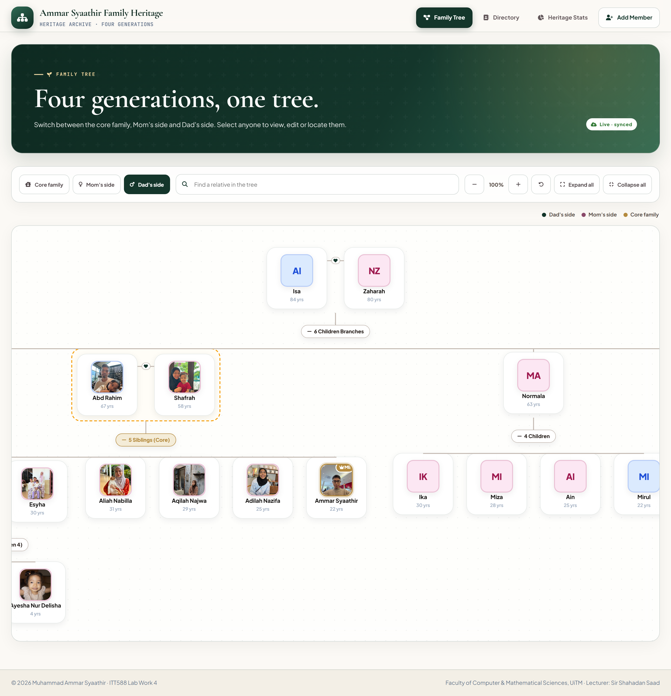
* **File:** `screenshots/02_dad_tree_full.png`
* **Features:** Comprehensive paternal pedigree tracking Atok Md Isa and Nenek Zaharah at the root, connecting horizontally to all 6 paternal uncle/aunt households (Paklong, Pakngah, Dad, Makteh, Acik Nora, Maksu Laili), with generation-tier markers and paternal forest-green color coding.

#### View 03: Mom's Side Ancestry Tree (Maternal)
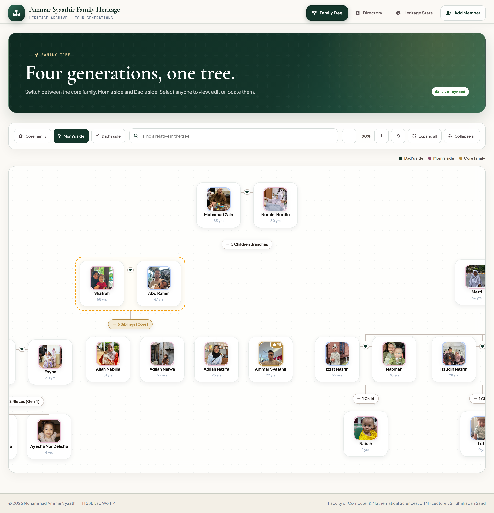
* **File:** `screenshots/03_mom_tree_full.png`
* **Features:** Comprehensive maternal pedigree tracking Atok Mohamad Zain and Nenek Noraini Nordin at the root, expanding downward to maternal uncle/aunt branches with emerald-green line connectors, full photo avatars, and kinship roles.

#### View 18: Tree Relative Search & Spotlight
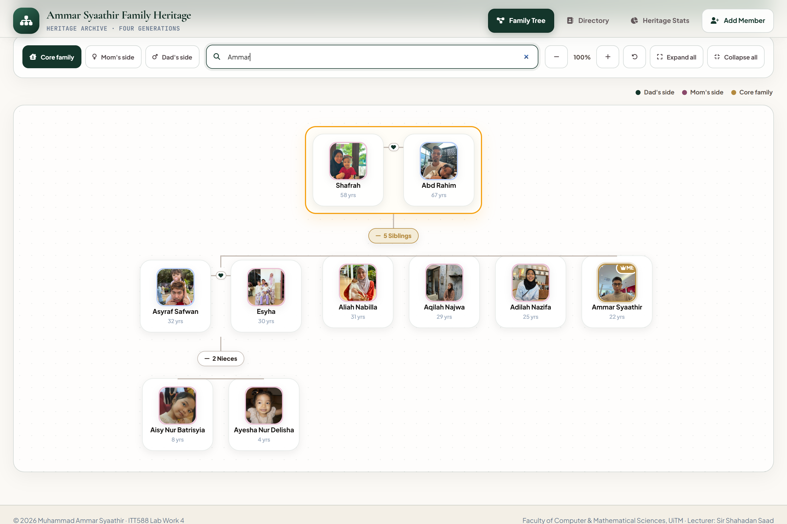
* **File:** `screenshots/18_family_tree_spotlight_search.png`
* **Features:** Interactive tree search bar (`#treeSearchInput`): typing "Ammar" immediately filters the canvas, automatically scrolls to the matching node, centers it in the viewport, and applies an ambient gold halo spotlight.

#### View 19: Interactive Zoom Controls & Scaling (130%)
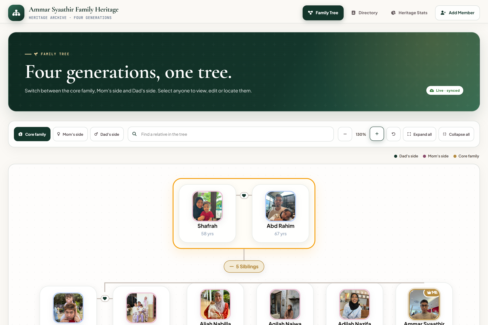
* **File:** `screenshots/19_family_tree_zoomed_controls.png`
* **Features:** Interactive zoom controls toolbar: clicking the zoom-in button (`+`) scales the SVG/DOM tree canvas smoothly to **130%**, showing the live zoom badge, allowing users to inspect close-up card details, relationship lines, and photo portraits at high DPI without distortion.

---

### 3. Member Directory & View Modes (`directory.html`)

#### View 06: Directory – By Family View (Expanded)
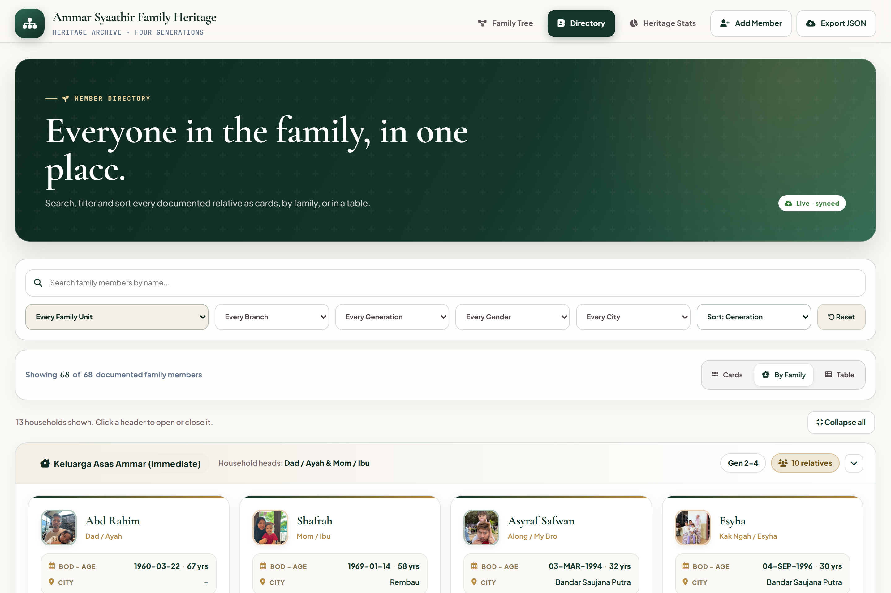
* **File:** `screenshots/06_directory_by_family_expanded.png`
* **Features:** Household grouped layout displaying redesigned member cards showing strictly: **NAME**, **BOD – AGE**, **CITY**, **LINEAGE & KINSHIP CONTEXT**, and the **4 Action Buttons** (`Tree`, `Edit`, `Profile`, `Copy ID`).

#### View 07: Directory – By Family View (Collapsed Accordion)
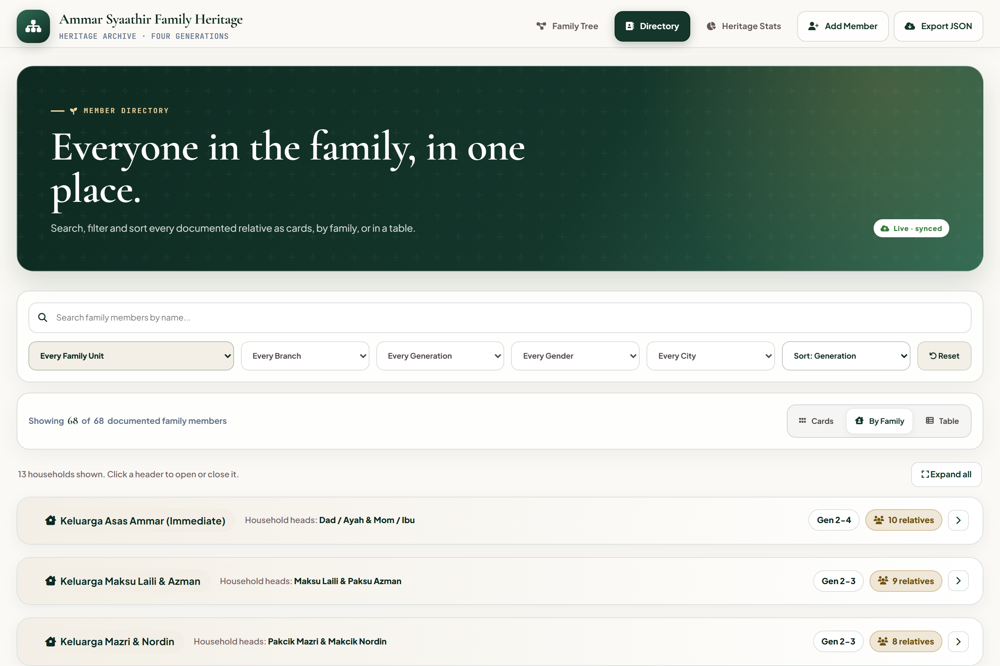
* **File:** `screenshots/07_directory_by_family_collapsed.png`
* **Features:** Accordion view of all 13 family household cards in their collapsed state. Each header displays the household title, identified household heads, generational span chip (`Gen 2–4`), and relative count chip (`10 relatives`), with one-click "Expand all / Collapse all" functionality.

#### View 12: Directory – Modern Cards Grid View Mode
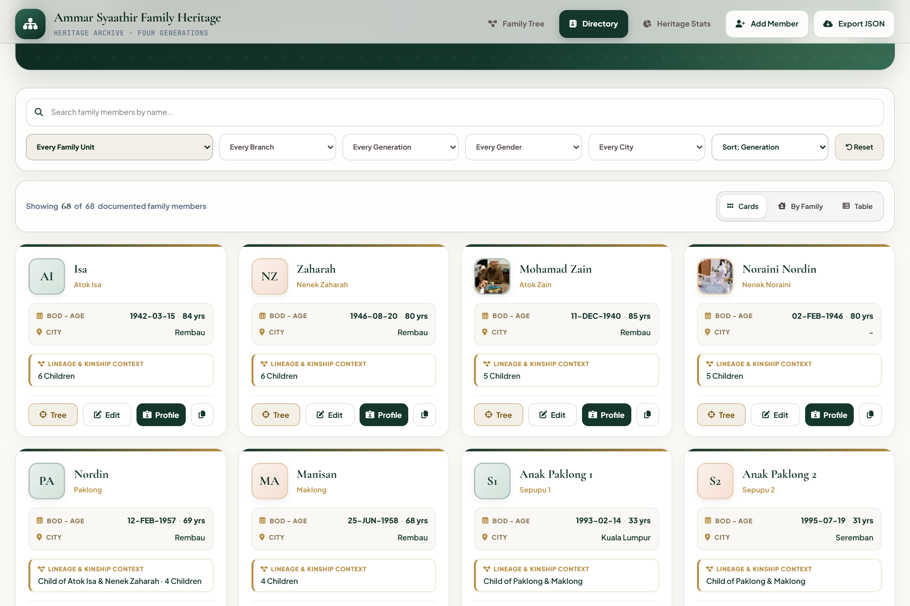
* **File:** `screenshots/12_directory_cards_grid.png`
* **Features:** Activated via the `[:: Cards]` toggle button. Displays an uncluttered, responsive multi-column grid of individual member cards sorted by generation and age, without household grouping containers.

#### View 08: Directory – 5-Column Table View
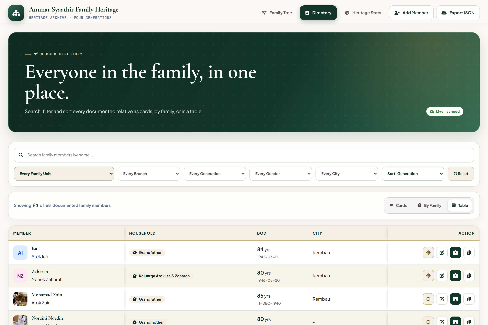
* **File:** `screenshots/08_directory_table.png`
* **Features:** Optimized tabular view strictly adhering to the 5 requested columns: **MEMBER** (Avatar, full name, nickname), **HOUSEHOLD** (family unit badge), **BOD** (Date of birth & computed age), **CITY** (locality), and **ACTION** (Tree spotlight, Edit, Profile modal, Copy ID).

---

### 4. Advanced Multi-Filtering & Search Engine

#### View 13: Live Name & Keyword Search ("Ammar")
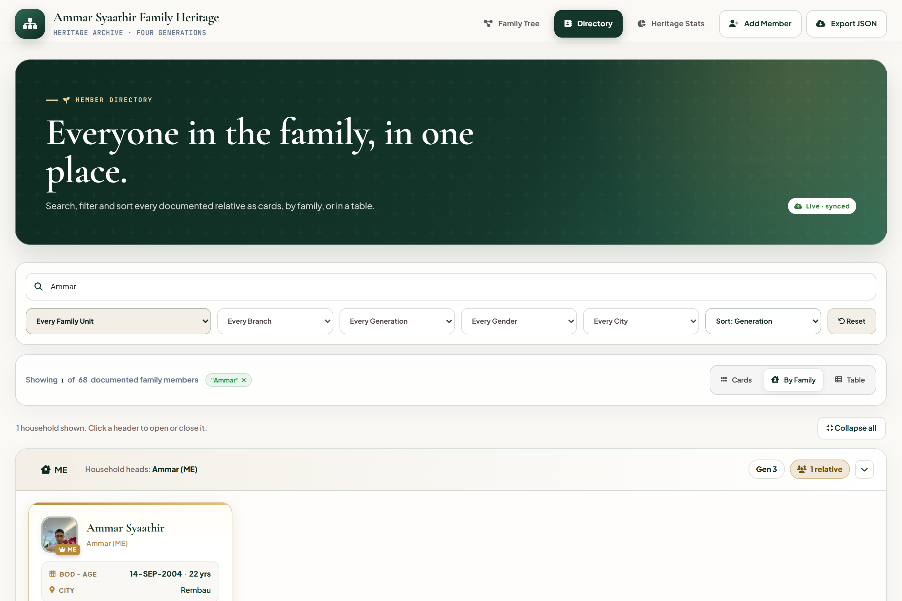
* **File:** `screenshots/13_directory_filter_search.png`
* **Features:** Real-time search filter: typing "Ammar" in the search box dynamically updates the counter to `Showing 1 of 68 documented family members`, adds the removable filter tag `["Ammar" ×]`, and isolates Ammar's card instantly with zero lag.

#### View 14: Filter by Family Unit ("Keluarga Asas Ammar")
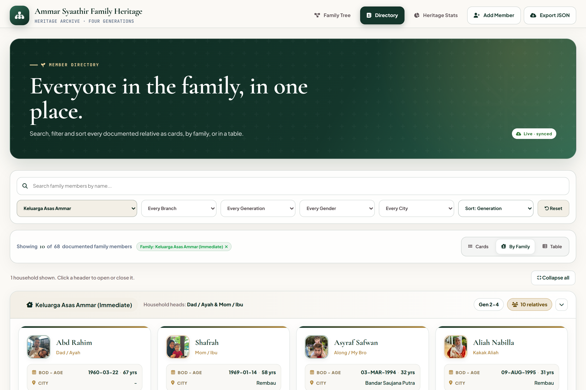
* **File:** `screenshots/14_directory_filter_family_unit.png`
* **Features:** Selecting a household from the **Family Unit** dropdown isolates that nuclear family. Displays the active badge `[Family: Keluarga Asas Ammar (Immediate) ×]`, updates the counter to `Showing 10 of 68`, and renders all 10 immediate relatives.

#### View 15: Combined Multi-Filtering (Branch + Generation + Gender)
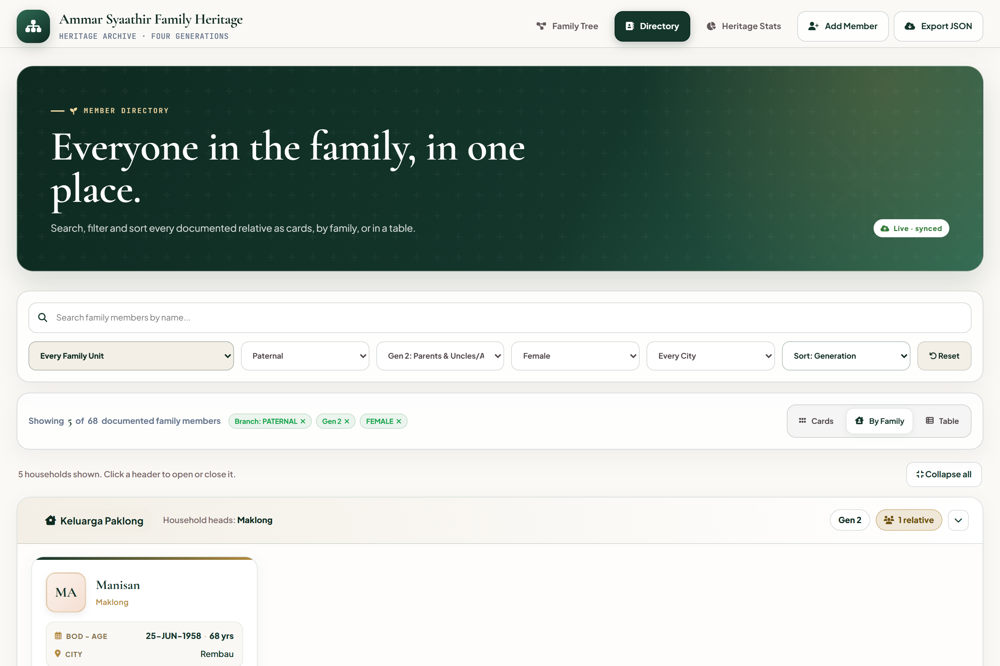
* **File:** `screenshots/15_directory_filter_branch_gender.png`
* **Features:** Demonstrates multi-criteria compound filtering: **Branch = Paternal**, **Generation = Gen 2**, and **Gender = Female**. The counter dynamically calculates `Showing 5 of 68 documented family members`, displaying 3 distinct removable filter tags and presenting only the matching aunts.

---

### 5. Profile Modals, Editing & Interactive Actions

#### View 04: View Profile Modal (Ammar)
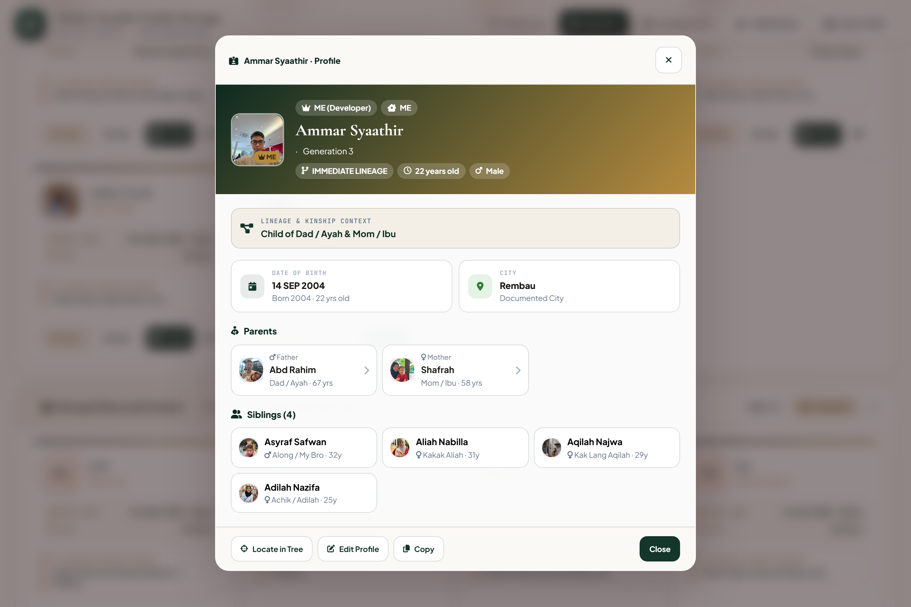
* **File:** `screenshots/04_view_profile_ammar.png`
* **Features:** Comprehensive read-only profile dialog for Ammar Syaathir. Features the high-resolution uploaded avatar hero, metadata pills (Role, Generation, Branch, City, Birthdate), biological parents with real photo avatars, and an interactive grid of siblings with their respective photos and kinship labels.

#### View 05: Add Member Form Modal
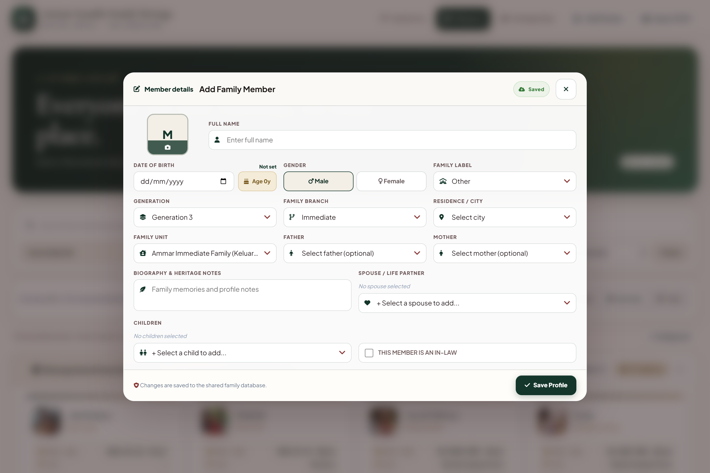
* **File:** `screenshots/05_add_member_form.png`
* **Features:** Modal for recording new relatives. Equipped with the **Family Unit** select dropdown, gender segmented bar, photo uploader, and interactive **Spouse IDs** dropdown selector and **Children IDs** dropdown selector allowing sequential selection of multiple children IDs.

#### View 16: Edit Member Modal (Existing Profile with Chips)
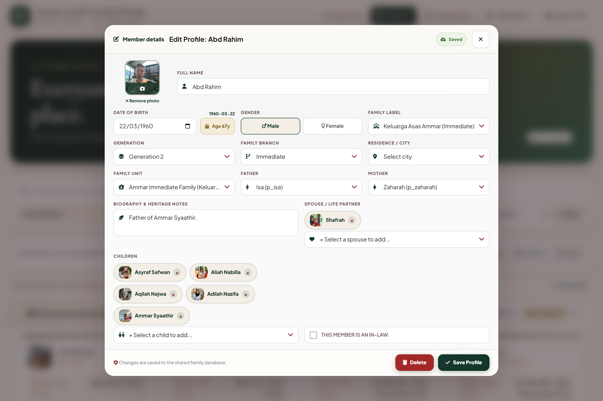
* **File:** `screenshots/16_edit_member_modal.png`
* **Features:** Demonstrates the editor populated with an existing relative's record (**Abd Rahim**). Displays the current avatar photo with "Remove photo" control, biological parent dropdowns, spouse chip (Shafrah) with remove badge (`×`), and 5 distinct children chips (Asyraf Safwan, Aliah Nabilla, Aqilah Najwa, Adilah Nazifa, Ammar Syaathir) each with their uploaded photo and remove button (`×`).

#### View 17: Interactive Card Action – Copy ID Toast Notification
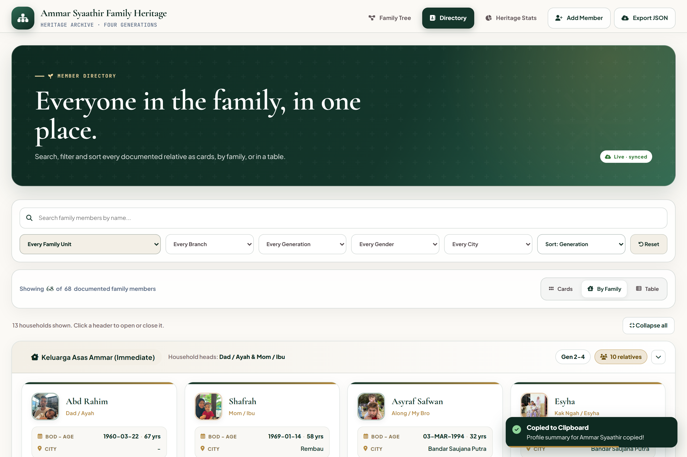
* **File:** `screenshots/17_directory_copy_id_toast.png`
* **Features:** Clicking the 4th action button (`Copy ID`) on any card invokes the Clipboard API and triggers an elegant dark emerald and gold floating toast notification in the bottom-right corner: *"✔ Copied to Clipboard - Profile summary for Ammar Syaathir copied!"*.

---

### 6. Demographics Intelligence & Heritage Stats (`stats.html`)

#### View 11: Heritage Stats (Desktop Full Dashboard)
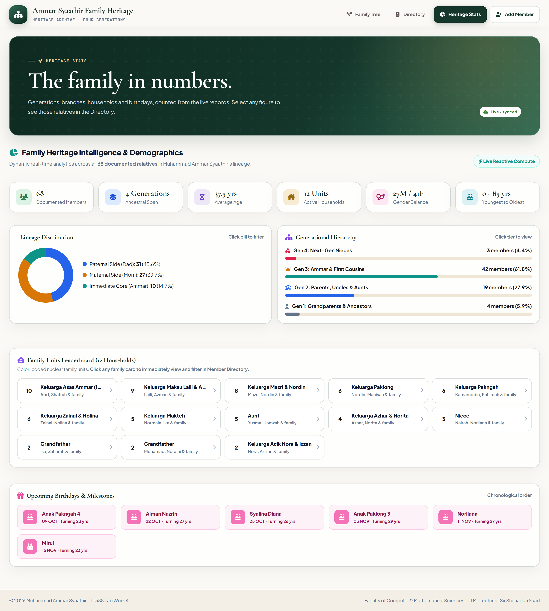
* **File:** `screenshots/11_stats_desktop_full.png`
* **Features:** Full analytics dashboard computed in real-time from the 68 database records:
  * **6 Executive KPIs:** Total Documented Members (68), Ancestral Span (4 Generations), Average Age (37.5 yrs), Active Households (12 Units), Gender Balance (27M / 41F), Age Range (0 to 85 yrs).
  * **Interactive Lineage Donut Chart:** Visualizes distribution across Paternal (31 / 45.6%), Maternal (27 / 39.7%), and Immediate Core (10 / 14.7%).
  * **Generational Hierarchy:** Proportional visual progress bars for Gen 1, Gen 2, Gen 3, and Gen 4.
  * **Family Units Leaderboard:** Interactive grid of all 12 households with member counts; clicking any card navigates to and filters the Directory.
  * **Upcoming Birthdays & Milestones:** Chronologically sorted upcoming birthdays calculated from date-of-birth fields.

#### View 09: Heritage Stats (Mobile Responsive View)
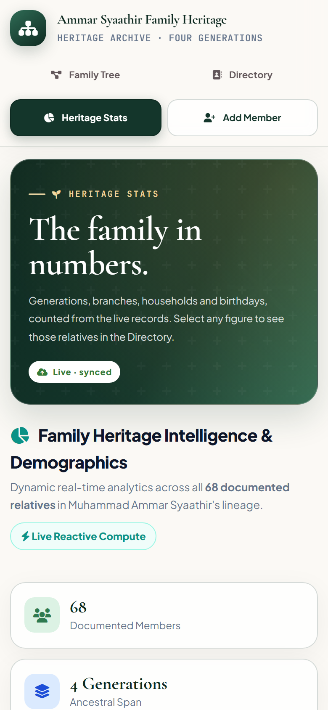
* **File:** `screenshots/09_stats_responsive.png`
* **Features:** Responsive mobile viewport (390 × 844 px) showcasing mobile-first flexbox/grid reflow, touch-friendly tap targets, legible typography scaling, and streamlined KPI card stacking.

---

## 🚀 Deployment & Local Setup

### Running Locally
```bash
# 1. Install dependencies
npm install

# 2. Run local Cloudflare Pages dev server with local D1 database
npm run dev
# Server boots at http://localhost:8788
```

### Deploying to Cloudflare Pages
```bash
# Deploy static dist directory and serverless functions directly
npx wrangler pages deploy dist --project-name ammar-family-heritage
```

---

## 📄 License & Academic Attribution
* **Author:** Muhammad Ammar Syaathir Bin Abd Rahim (2025179251)
* **Course:** ITT588 Front-End Technology &middot; Universiti Teknologi MARA (UiTM)
* **Class:** CS2666B &middot; **Lecturer:** Sir Shahadan Saad
* **Year:** 2026
